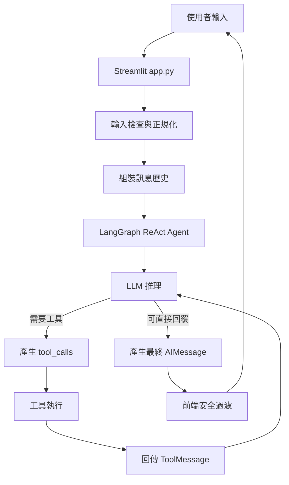
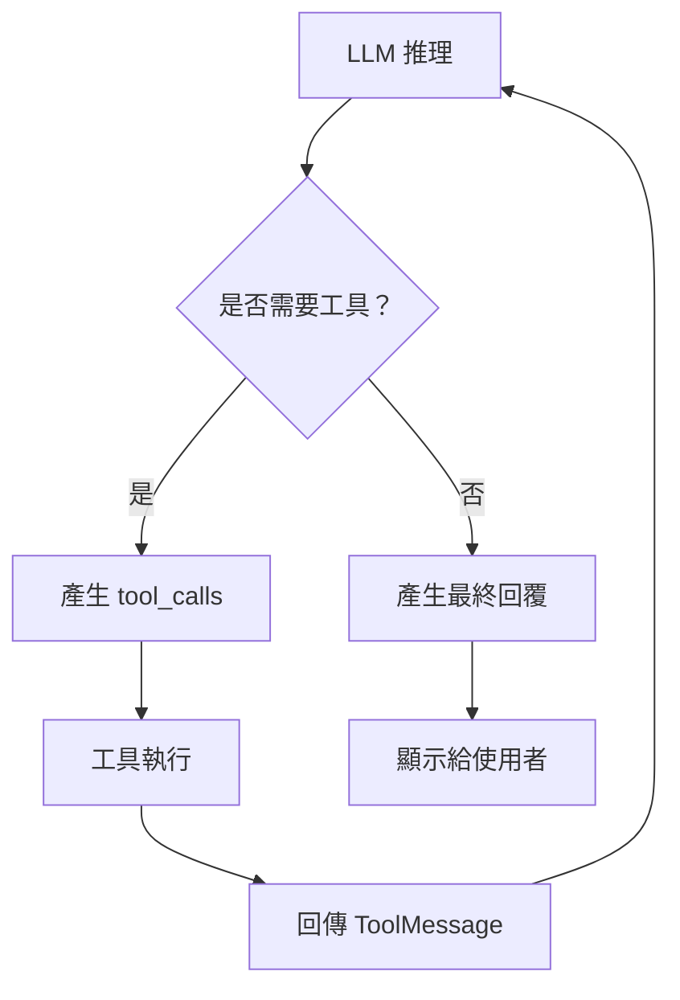

# 星光大學校園助手（LangGraph ReAct PoC）

本專案的重點不是重新實作討論室預約系統，而是：

> **將原本以程式主導控制流的討論室預約流程，改造成 LangGraph ReAct Agent。**

也就是說，前一版專案的重點是：

```text
使用者輸入
→ 程式解析
→ 程式判斷流程
→ 呼叫資料庫
→ 回傳結果
```

本版則嘗試改成：

```text
使用者輸入
→ LLM 理解語意
→ LLM 判斷是否需要工具
→ Agent 呼叫工具
→ Agent 根據工具結果繼續推理
→ LLM 產生自然語言回覆
```

因此，本專案的核心價值在於：

- 驗證如何使用 LangGraph 建立 ReAct Agent
- 驗證如何把既有預約服務包裝成 LLM 可呼叫工具
- 驗證 LLM 如何在多輪對話中追問、確認與執行工具
- 觀察程式主導流程與 LLM 主導流程的差異
- 處理 ReAct 架構下的 Prompt、工具描述與輸出穩定性問題

輸入前處理，例如字元白名單、長度限制與 Unicode 正規化，是沿用前一版專案的做法，僅作為基本安全檢查，不是本次重點。

---

## 本專案與前一版專案的差異

| 項目 | 前一版：程式主導流程 | 本版：LangGraph ReAct |
|---|---|---|
| 使用者意圖理解 | 程式判斷 | LLM 理解 |
| 是否呼叫工具 | 程式流程決定 | LLM 推理決定 |
| 缺少欄位時 | 程式固定追問 | LLM 依對話脈絡追問 |
| 預約確認 | 程式流程控制 | LLM 先整理資訊並請使用者確認 |
| 工具呼叫 | 程式直接呼叫服務層 | Agent 透過工具層呼叫服務層 |
| 回覆生成 | 較固定 | 由 LLM 依結果生成自然語言 |
| 主要挑戰 | 業務流程與驗證 | Prompt、工具描述、模型穩定性、輸出護欄 |

---

## 技術架構

- Python
- Streamlit
- LangChain
- LangGraph
- Ollama
- SQLite

使用模型：

```text
qwen2.5:7b
```

Agent 建立方式採用較標準的寫法：

```python
create_react_agent(
    model=llm,
    tools=tools,
)
```

由 LangGraph 內部處理工具綁定與工具節點流程。

---

## ReAct 流程詳解

ReAct 是 **Reasoning + Acting** 的結合。  
在本專案中，Agent 會依照下列循環運作：

1. 理解使用者需求
2. 推理接下來該做什麼
3. 決定是否呼叫工具
4. 執行工具取得觀察結果
5. 根據觀察結果繼續推理
6. 產生最終自然語言回覆

---

## 整體流程圖



---

## ReAct 循環示意



---

## 一次完整請求流程

### 1. 使用者輸入

使用者輸入自然語言需求，例如：

```text
現有預約?
```

---

### 2. 輸入前處理

系統先透過 `input_guard.py` 做基本輸入檢查：

- 檢查長度
- 檢查白名單字元
- Unicode 正規化
- 正規化後再次檢查

這部分沿用前一版專案，僅作為基本安全檢查。

---

### 3. 組裝訊息歷史

`app.py` 會將聊天紀錄轉換為 LangChain 訊息格式：

- `SystemMessage`
- `HumanMessage`
- `AIMessage`

System Prompt 會由 `app.py` 在每次請求時動態產生，確保日期資訊是最新的。

---

### 4. 呼叫 LangGraph Agent

程式執行：

```python
result = agent.invoke({"messages": lc_messages})
```

LangGraph 會將整段對話交給 Agent 處理。

---

### 5. LLM 推理

LLM 會根據系統提示、歷史對話與可用工具，判斷下一步。

例如使用者說：

```text
現有預約?
```

LLM 會判斷這是查詢目前使用者自己的預約，因此直接呼叫：

```python
get_my_bookings
```

而不是詢問使用者姓名或學號。

---

### 6. 工具呼叫

若 LLM 需要查詢資料，會產生標準 `tool_calls`。

例如：

```text
get_my_bookings
```

或：

```text
list_rooms
```

---

### 7. 工具執行

LangGraph 會根據 `tool_calls` 執行工具。

工具結果會以 `ToolMessage` 回傳給 Agent。

---

### 8. LLM 根據工具結果繼續推理

LLM 拿到工具結果後，會再次判斷：

- 是否還需要呼叫其他工具？
- 是否資料已足夠？
- 是否需要追問使用者？
- 是否可以產生最終回覆？

若還缺資料，就繼續循環；若資料完整，就產生最終回覆。

---

## 預約建立流程範例

### 使用者輸入

```text
我想預約明天下午兩點的 B01 討論室，大概 5 個人。
```

### Agent 回覆

```text
好的，我已收到部分資訊。請問預計使用到幾點？另外請提供預約事由。
```

### 使用者補充

```text
到下午四點，事由是專題開會。
```

### Agent 確認

```text
請確認以下預約資訊：

討論室：B01
人數：5 人
開始時間：2026-10-27 14:00
結束時間：2026-10-27 16:00
事由：專題開會

請問以上資訊正確嗎？確認後我將為您送出預約。
```

### 使用者確認

```text
確認。
```

### Agent 呼叫工具

```python
create_booking(
    room_id="B01",
    people_count=5,
    start_time="2026-10-27 14:00",
    end_time="2026-10-27 16:00",
    reason="專題開會"
)
```

### 最終回覆

```text
預約成功！預約編號：#12。
```

---

## 既有預約功能

以下功能沿用前一版討論室預約專案的業務邏輯，本版主要把它們包裝成 Agent 可呼叫的工具。

- 查詢開放中的討論室與容量
- 查詢目前使用者的有效預約紀錄
- 建立討論室預約
- 取消討論室預約
- 預約欄位驗證
- 時段衝突檢查
- 開放時間檢查
- 輸入白名單與正規化

---

## 工具清單

### `list_rooms`

查詢目前開放的討論室清單。

```text
編號: A01, 容量: 4人
編號: B01, 容量: 6人
```

---

### `get_my_bookings`

查詢目前登入使用者的有效預約紀錄。

此工具不需要任何參數。  
系統已綁定目前使用者，因此不會詢問姓名或學號。

---

### `create_booking`

建立新的討論室預約。

參數：

| 參數 | 說明 |
|---|---|
| room_id | 討論室編號 |
| people_count | 人數 |
| start_time | 開始時間，格式為 `YYYY-MM-DD HH:MM` |
| end_time | 結束時間，格式為 `YYYY-MM-DD HH:MM` |
| reason | 預約事由 |

---

### `cancel_booking_tool`

取消指定預約。

參數：

| 參數 | 說明 |
|---|---|
| reservation_id | 預約編號，純數字 |

---

## System Prompt 設計

本專案的 System Prompt 採用精簡版設計，只保留核心規則：

- 角色設定
- 目前日期
- 使用者身份已綁定
- 禁止詢問姓名或學號
- 查詢預約時直接呼叫 `get_my_bookings`
- 建立預約需收集五個欄位
- 預約前需使用者確認
- 取消前需先查詢並確認
- 工具失敗時需以自然語言說明

工具細節則交由工具本身的 `docstring` 描述。

這樣做的原因是：

> 本地 7B 模型在過長或過複雜的 System Prompt 下，較容易產生不穩定的工具呼叫行為。  
> 精簡提示詞有助於維持標準 `tool_calls` 流程。

---

## Prompt 長度與 Tool Calling 穩定性

在開發過程中曾觀察到：當 System Prompt 加入較完整的工具說明、業務規則、互動原則與範例後，特定輸入例如：

```text
現有預約?
```

會穩定出現非標準工具呼叫輸出，例如：

```text
ilor
{"name": "get_my_bookings", "arguments": {}}
</tool_call>
```

而不是預期的：

```python
AIMessage.tool_calls
```

這代表模型雖然知道應該呼叫 `get_my_bookings`，但它沒有走框架預期的結構化 Tool Calling 通道，而是把工具呼叫當成一般文字輸出。

由於本專案使用：

```python
temperature=0
```

此現象在相同輸入與相同模型配置下會穩定重現，因此較難歸類為隨機幻覺。

同時，當時的 Prompt 長度並未超過 `qwen2.5:7b` 的上下文限制。因此較合理的解釋是：

> Prompt 雖然沒有超過模型可接受的上下文長度，但其規則數量、描述複雜度與重複說明，可能超過該模型在工具呼叫任務上能穩定遵循的範圍。  
> 在這種情況下，模型對結構化 Tool Calling 格式的遵循能力下降，進而出現原始工具呼叫文字。

因此，本專案最終採取以下策略：

- 避免使用過長 System Prompt
- 僅保留最關鍵的角色與流程規則
- 將工具用途與限制寫在工具 `docstring`
- 減少範例與重複說明
- 使用前端 Guard 防止異常輸出直接暴露給使用者

---

## ReAct 開發取捨

相較於前一版程式主導流程，ReAct 架構的開發重點明顯不同。

前一版主要處理：

```text
業務流程
欄位驗證
資料存取
固定錯誤訊息
```

本版則需要額外處理：

```text
Prompt 穩定性
工具描述
模型是否產生標準 tool_calls
模型是否會詢問不需要的資訊
模型是否會輸出原始工具呼叫文字
是否需要前端輸出過濾
是否需要 Guard 做最後保護
```

因此，ReAct 版本的成本不只是接上 LangGraph 或工具，而是要持續在以下幾件事之間取得平衡：

- 模型自由度
- 業務可控性
- Prompt 長度
- 工具描述清楚程度
- 輸出安全性
- 本地模型能力

在目前使用相同本地模型，且不導入微調或更強模型的前提下，可透過 Prompt 工程優化的空間相對有限。  
因此本專案目前先以可穩定展示 ReAct 核心流程的版本作為階段性成果。

---

## 錯誤處理與保護機制

為避免工具失敗或模型異常輸出直接暴露給使用者，本專案有以下保護機制：

### 1. 工具層保護

`tools.py` 中所有工具皆回傳自然語言字串。

即使底層發生例外，也會回傳友善訊息。

---

### 2. 業務邏輯保護

`booking/service.py` 負責業務規則驗證，例如：

- 人數不可低於 2
- 人數不可超過容量
- 時間格式錯誤
- 結束時間需晚於開始時間
- 不可預約過去時間
- 時段衝突
- 事由不合法

---

### 3. 前端輸出保護

`app.py` 會過濾最終訊息：

- 不直接顯示原始工具呼叫文字
- 不直接顯示 JSON 格式錯誤
- 不直接顯示技術錯誤訊息
- 若模型誤問姓名或學號，啟動備援查詢
- 若偵測到原始 `tool_call` 輸出，啟動友善回覆

---

## 預約業務規則

### 人數限制

- 人數需大於等於 2
- 人數不可超過討論室容量

### 時間規則

- 時間格式：`YYYY-MM-DD HH:MM`
- 結束時間需晚於開始時間
- 不可跨天
- 不可預約過去時間

### 開放時段

週一至週五：

```text
08:00–21:30
```

週末：

```text
09:00–17:30
```

### 事由規則

事由不可為空白、過短、無意義或測試用途。

---

## 快速開始

先下載並啟動 Ollama 模型：

```bash
ollama pull qwen2.5:7b
ollama serve
```

安裝 Python 套件：

```bash
pip install streamlit langchain-core langchain-ollama langgraph
```

執行專案：

```bash
streamlit run app.py
```

首次執行時，專案會自動建立 SQLite 資料庫與預設討論室資料。

---

## 測試

專案提供簡單工具測試：

```bash
python test_tools.py
```

可用來確認：

- 資料庫是否正常初始化
- `get_my_bookings` 是否可正常執行

---

## 目前限制

本專案為 PoC，不包含正式產品級功能。

- 使用者身分固定為 `S123456789`
- 尚未提供修改預約功能
- 使用本地 SQLite，不適合多使用者正式環境
- 本地 7B 模型的複雜指令穩定度有限
- Prompt 長度與複雜度會影響 Tool Calling 穩定性
- ReAct 流程仍需依賴 Prompt、工具描述與前端 Guard 維持穩定

---

## 後續可優化方向

若未來要繼續優化，可從以下方向著手：

- 使用工具呼叫穩定度更高的模型
- 導入結構化輸出或更嚴格的工具參數驗證
- 建立評估案例與回歸測試
- 加入意圖分流，先處理高頻明確指令
- 加入對話狀態管理，降低模型對歷史訊息的依賴
- 對本地模型進行微調或工具呼叫格式訓練
- 將預約確認等關鍵流程加入程式層狀態控制

不過，在維持相同本地模型的前提下，僅靠 Prompt 工程能優化的幅度有限。  
若要明顯提升穩定度，通常需要搭配更強模型、微調或更完整的 Agent 評估框架。

---

## License

Copyright © 2026 hanwu910514.

詳情請參閱[Apache License 2.0](LICENSE)檔案
